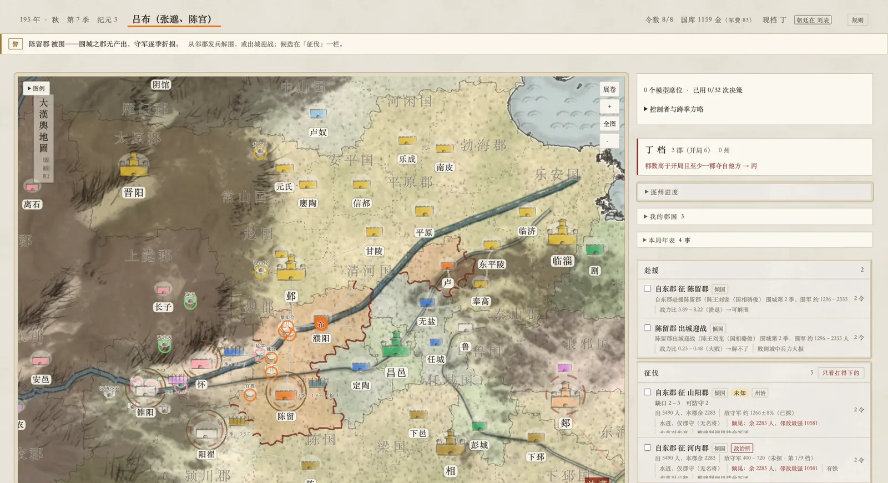
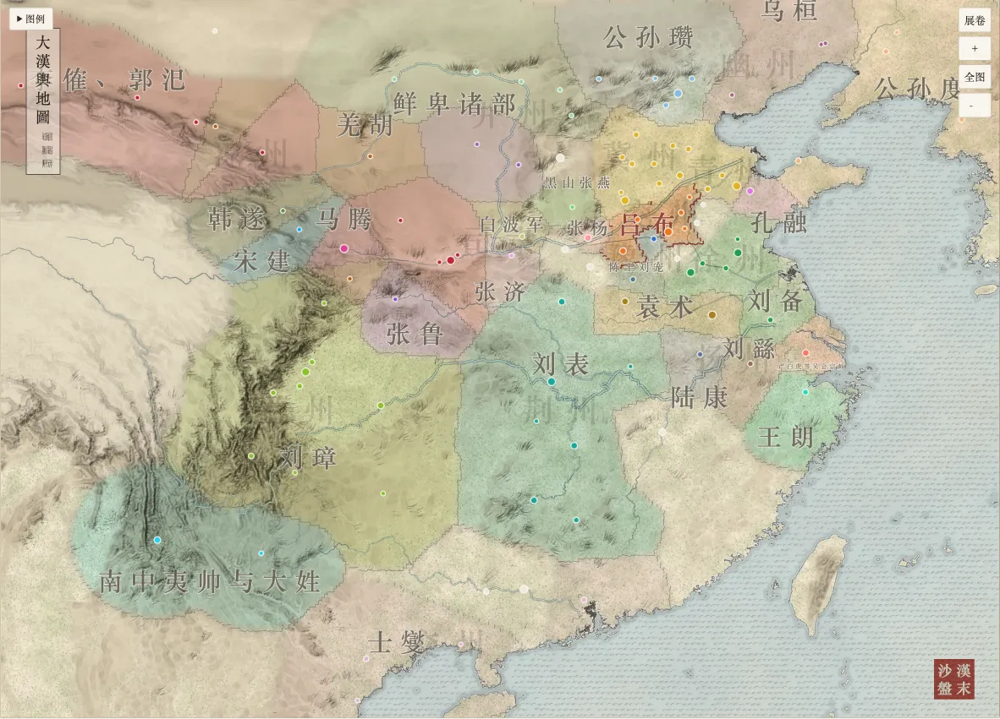
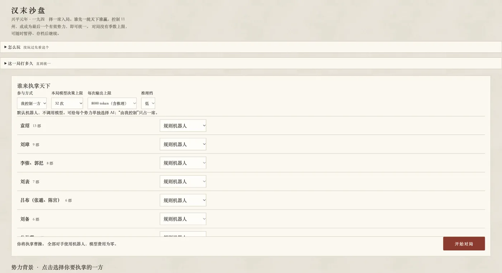

[中文](README.md) · [English](README.en.md)

# Mind Arena · 汉末沙盘

**A Three Kingdoms grand-strategy game on the 194 CE map, where every faction can
be driven by a human, a rule-based bot, or a separately chosen AI model.** The same
engine and decision protocol back both play and model evaluation. The game and its
interface are in Chinese; the documentation is bilingual — see
[README.en.md](README.en.md).

---

兴平元年（194 年），三十一家势力、一百零五个郡国。每一家都可以由你、由内置
机器人、或者由**一个你单独指定的大模型**执子——它们下的是同一套令，走的是
同一条裁决路径。

另有一个剧本：**建安五年·官渡前夕**（200 年正月，二十家）。袁绍已据河北四州，
曹操挟天子屯官渡，刘备方杀车胄据下邳，孙策尽有江东而四月将遇刺，张羡举长沙、
零陵、桂阳三郡叛刘表。选席页可切换。

这既是一个能玩的游戏，也是一套**用游戏评测大模型**的装置：同一个局面发给不同
的模型，看它们各自怎么下令、怎么跨季修正、怎么在十六季里把一手牌打成什么样。



<sub>对局中。顶栏告警「陈留郡被围」；图上军团带势力字、关渡带归属色环；
右栏是引擎预筛出的候选，每条带战力比或破城预告。</sub>

| 势力图（整幅） | 选席 |
| --- | --- |
|  |  |
| 缩小看天下大势：疆域色块、势力名、州名水印，不画城印 | 三十一家，各有史实小传与开局态势 |

## 跑起来（零配置）

```bash
git clone <repo> && cd mind-arena
npm install
npm run dev          # 打开 http://localhost:3000/play
```

**不需要环境变量、不需要数据库、不需要云账号。** 所有对手默认是内置机器人，
开局、对弈、存档续盘全在本地完成，一分钱不花。地图、城印、武将数据都已随仓库
发布（约 22 MB），clone 下来即可用。

需要 Node.js `>=22.13.0`。

## 让某一方由真的大模型执子（可选）

```bash
cp .env.local.example .env.local   # 填入你自己的 OPENROUTER_API_KEY
npm run dev
```

在开局配置里给任意势力单独挑一个模型，其余势力仍可以是机器人或你自己。
密钥只被服务端路由读取，**不会以 `NEXT_PUBLIC_*` 的形式进到浏览器**；
`.env.local` 在 `.gitignore` 里，仓库里只有占位符样例。

浏览器跑的是和评测工具**同一个** `modelDecide`——同一份观测、同一套准入、
同一组失败分类，`/api/openrouter/chat` 只做服务端代理。

每局有决策次数额度与单次输出上限（含推理）。一季开始前若额度不够覆盖所有
模型席位，会先暂停并问你是追加 16 次还是让机器人接手。**那是请求次数的闸，
不是金额的闸**——面板会显示供应方报告的花费，并标出花费未知的那几次。
模型失败时该席位**不下令**、明确记录、并停止自动推进；绝不悄悄回落到机器人。

## 怎么玩

选一席入局，或者选**纯观战**让所有势力自动行动。每季从引擎给出的候选里勾几条
令，封令结算，看战报。

- **胜负**：控制 11 个州，或成为最后一个有效势力。玩家局**没有季数上限**，
  可随时暂停、存档、续盘。（评测用的是另一套：固定 16 季，按相对开局的增量定档。）
- **地图**：一百零五个郡国，两个剧本共用同一张。缩小是势力图，放大到四倍是棋盘——城、路、路上的
  关隘渡口、走在路上的部队、看得懂的围城。地色由**通行代价场**画出：
  深色难走、黑色过不去，关与渡口就是墙上的豁口。
- **据点**：关隘、谷道、渡口、港、仓都有主，可占可守可打。扼于某处的加成归
  那处的主人——你据了关，守方就没有关隘之利。
- **调兵**：相邻己方郡之间可以把守军运往前线，单季最多调出初始守军的一半。
- 选席页有「怎么玩」，对局中顶栏有「规则」，都是同一份。

进度存在 `localStorage`：待决的勾选、控制者分配、AI 的跨季计划、被拒的令、
决策记录与已用额度都在内。**规则包或存档格式一变就拒绝读档，不做静默迁移**——
悄悄读进来的旧档会在新规则下继续跑，而错得不响。

## 设计上的几个决定

这些是这个项目和一般三国游戏不同的地方，也是它为什么能用来评测模型。

- **模型做的是选择题，不是填空题。** 引擎预筛出实际可行的候选，模型按 key 挑。
  不这样的话行动空间会炸开，评出来的是「谁更会猜格式」。
- **地图是一张代价场，不是一张图。** 「谁能打谁」由地形算出来——从 105 个治所
  同时做 Dijkstra，辖境相接即为邻。不是谁事先画了线。
- **规则即数据。** 全部战斗与结算常数收在 `lib/game/content/pack-194.json`，
  缺任何一项即启动报错。改一个数，引擎、模型读到的规则摘要、观测、界面四处
  必须同步——有测试钉住。
- **冻结闸。** 规则数值有指纹；改动必须升版本、记一条「改了什么/为什么/后果」、
  重跑免费基线。它已经抓出过三个真问题，包括一次版本号升了而记载没跟上。
- **先用免费的验。** 玩法改动一律先跑机器人自对局（`npm run selfplay`，四道
  验收闸），过了再谈模型。

## 目前的边界

写在前面，免得你以为它已经解决了：

- **模型能不能被纠正，仍然没有定论。** 决策复盘会把「下了什么令、哪条被丢了、
  为什么」连同实际战果喂回下一季。一次[六决策的回执实测](docs/DECISION-CORRECTION-2026-09-28.md)
  花了 $0.01073：Flash-Lite 认出了迁走的治所，Nano 仍然搞混目标与命令，
  两边各丢三条令。[另一次跟进](docs/DECISION-GUIDANCE-2026-09-29.md)止住了
  Nano 重复虚假目标，别的计划与命令错误照旧。
- **势力不平衡，而且查清了原因。** 统一模式 24 局：20 局自然统一（19–50 季，中位 30），
  **全部是袁绍**；余下 4 局跑满 64 季未分胜负，3 局仍由袁绍领先。为此改过
  四处（坚城线、联军可复发、攻破消化成本、令数曲线四种形状），**四处全部
  失败**——都不是绑定约束。真正的量在开局就定死：曹操身边有它 21.86 倍的
  兵，袁绍身边只有 1.57 倍。全局旋钮改不动一个**席位之间的比值**。
  十六季评测不受影响（开局郡数 ↔ 疆域增量 ρ = −0.13，开局大不占便宜）。
  全过程见 [docs/BALANCE-2026-10-16.md](docs/BALANCE-2026-10-16.md)。
- [固定局面的模型对照](docs/DECISION-COMPARISON-2026-09-28.md)比了 nano、
  Flash-Lite、mini 共九次决策：mini 被校验丢弃的令更少，但计划一致性仍未解决。
  **那不是胜率排名。**
- 县不是对局单位，地图的原子是郡。
- 没有忠诚度模型，武将不会自己叛变。
- 两个剧本（194 兴平元年、200 建安五年），都只有一张图。**建安五年的机器人
  自对局 8 局统一 6 局，赢家仍是袁绍**，而机器人执曹操多半被灭——他开局
  二十四郡十四万七千兵却有十一条战线（袁绍六条），邻里压力 2.73 对 1.24。
  史实上曹操本就是险胜的一方——而**模型执曹操能赢**：同种子配对下，
  `glm-5.3-flash` 执曹操 64 季局 **4/4 一统天下**（84–94 郡、11 州），
  而最强的机器人画像在六个种子上 **0/6**（17–25 郡）。模型侧实扣 $0.4775。
  但差距的含义比第一眼小：把决策逐条分类后，那个对照画像**六成的令花在换防、
  征伐只占 1–2%，集结与取据点全是零**——它不是打得差，是几乎不打。
  n=4、一个模型、一个对照画像，见 [docs/EVAL.md](docs/EVAL.md) 第 39 条。
  十六季评测口径下四道闸 4/4（开局郡数 ↔ 得分 ρ = 0.31）。**刘表那一席
  六十局里出局三十五局、四十五局落丁档**——他三个郡顶四条战线（北曹操、
  南张羡、东孙策、西刘璋），邻里压力 13.96，得分接近随机，故**不列入评测
  轮换**；换成一郡开局的张鲁（出局 23%，档位铺开四档），那道「一郡开局不
  必然出局」的判据于是在本剧本也有了着落。刘表仍可选来玩，只是不当量尺。
- 仅桌面端。

## 开发与评测

```bash
npm test          # 211 条回归测试：引擎、模型客户端、会话
npm run lint
npm run typecheck
npm run selfplay  # 机器人自对局 + 四道验收闸（免费）
npm run playtest  # 三场 64 季长局，走浏览器同一条推进路径（免费）
```

评测工具（会真的调模型，需要上面那个 key）：

| 命令 | 做什么 |
| --- | --- |
| `npm run eval` | 一个对局方跑 N 局 |
| `npm run eval:suite` | 几个对局方跑同一批 seed，出排行榜 |
| `npm run eval:dissect` | 把一次运行拆开看：按席位、动作构成、被丢的令、令数用率 |
| `npm run models` | 开榜前的供应方调研：每 48 局的价钱、是否支持结构化输出、实测吞吐 |
| `npm run build:board` | 压成 `/board` 页要的榜单；**拒绝混合规则指纹不同的对局方** |
| `npm run verdict` | 检查粗尺（档位）与连续尺（州进度）是否一致 |
| `npm run obs:budget` | 逐席位的观测 token 闸（超了退出码 1） |

[docs/EVAL.md](docs/EVAL.md) 记着这套评测被什么约束着——包括**一份排行榜
会以哪两种方式悄悄变成谎话**。[docs/ARCHITECTURE.md](docs/ARCHITECTURE.md)
是对局协议与公平性模式。

## 重新生成地图（大多数人用不到）

仓库里**已经带了成品**：941 块瓦片、55 个城印、通行代价场、道路与疆域栅格，
约 22 MB，clone 下来直接能用。只有想改地图本身的人才需要下面这些。

```
refs/dem-raster.raw  (283 MB，不入库，需自行下载)
  → npm run map:base4x → han-terrain-4x.png (172 MB，中间产物，不入库)
      → npm run map:tiles → public/game/map/tiles/    ← 运行时用这个
      → npm run map:play  → public/game/map/play-base.webp
```

那两个大文件**刻意不入库**：`han-terrain-4x.png` 单个 172 MB，超过 GitHub
单文件 100 MB 的上限，带着它仓库根本推不上去；而运行时一个字节都用不到它。
高程来自 [AWS Terrain Tiles](https://registry.opendata.aws/terrain-tiles/)
（terrarium，公有领域），取的范围记在 `refs/dem-raster.json`。

`npm run map:all` 跑完整条链。另有两条独立于地形的：`npm run map:cost`
重算通行代价场（决定哪儿走得通、关隘扼守多少价值），`npm run map:cost:report`
打印它的验收报告。

## 许可证与数据出处

代码按 [MIT](LICENSE) 发布。

打包进来的史料与地理数据全部是**公有领域或开放数据**——《三国志》《后汉书》
《续汉书·郡国志》等古籍，AWS Terrain Tiles 的高程，Natural Earth 的海岸线
与水系。郡治与据点坐标由现代地名反查得出，逐条标注了 certainty 与史料依据。

项目**刻意回避了带非商业条款的数据集**：CHGIS / 复旦 TGAZ 是 CC BY-NC，
只在研究阶段用来校对过坐标，没有任何数据打包进来。逐条出处见 [NOTICE.md](NOTICE.md)。

当前规则包 2.6.0，存档格式 12；旧存档需要重开一局。
